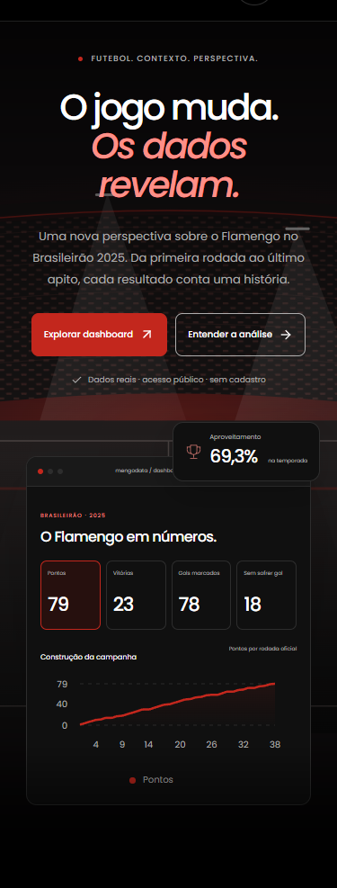
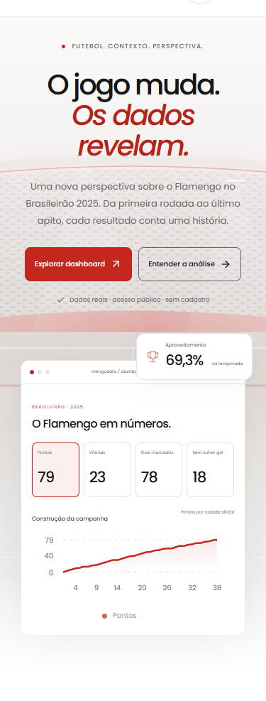
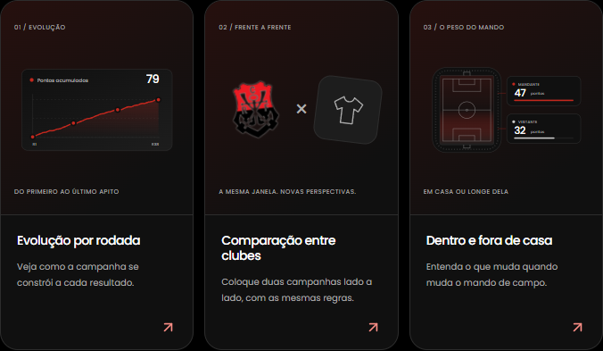

## MengoData

O MengoData é um projeto acadêmico desenvolvido para a disciplina de Big Data com Python. O objetivo é organizar, analisar e apresentar os resultados do Campeonato Brasileiro Série A masculino de 2025, com dados dos 20 clubes ao longo das 38 rodadas.

Escolhemos criar uma aplicação web para facilitar a exploração dos dados. Nela, é possível consultar partidas e indicadores e comparar o desempenho dos clubes. Usamos Python no processamento e na análise dos dados, além de React, Vite e uma API em Node.js para construir a aplicação.

O projeto nos permitiu colocar em prática os conceitos estudados na disciplina e também aprender mais sobre desenvolvimento web, integrando as duas áreas em uma única solução.

## Capturas de tela

| Página inicial Dark | Página inicial White | Opções |
|---|---|---|
|  |  |  |

## Início rápido

### Requisitos para abrir o site

- Windows 11 e PowerShell (as instruções abaixo usam PowerShell).
- Node.js 24.x e npm.
- Acesso à internet na primeira instalação das dependências.

Python e PostgreSQL não são necessários para abrir a aplicação com os dados locais incluídos. Python é usado para reproduzir o pipeline analítico e os notebooks. PostgreSQL é opcional para executar a API conectada a um banco.

Na raiz do repositório, instale as dependências:

    npm.cmd ci

Abra dois terminais PowerShell, ambos na raiz do projeto.

Terminal 1 — API:

    npm.cmd run dev:backend

Terminal 2 — site:

    npm.cmd run dev:frontend

Acesse:

- Site: http://127.0.0.1:5173/
- Dashboard: http://127.0.0.1:5173/dashboard
- Verificação de saúde da API: http://127.0.0.1:3001/api/health

A API usa os dados analíticos locais quando `DATABASE_URL` não está configurada. Para esse modo, não crie um arquivo `.env` copiando os valores fictícios de `.env.example`.

## O que há no projeto

- Frontend React, Vite e Recharts.
- API Express.
- Dados coletivos dos 20 clubes: 380 partidas e 38 rodadas.
- Pipeline de dados em Python, com Pandas, NumPy e Parquet.
- Páginas de partidas, classificação calculada, comparação, ataque, defesa, estatísticas e metodologia.

Os dados não incluem estatísticas individuais como posse de bola, passes ou gols esperados (xG). Consulte a metodologia antes de interpretar os indicadores.

## Banco de dados (opcional)

Sem `DATABASE_URL`, a API lê os dados locais. Para conectar a um PostgreSQL, instale e inicie uma instância local, configure uma URI válida em `DATABASE_URL` no arquivo `.env` da raiz e reinicie a API.

Os comandos de banco são explícitos:

    npm.cmd run db:check
    npm.cmd run db:migrate
    npm.cmd run db:import

db:check diagnostica a conexão; db:migrate aplica a migração coletiva; db:import importa os dados. A API não executa migrações automaticamente ao iniciar. Não use a senha fictícia do .env.example como credencial real. Mais detalhes: guia de banco em database/README.md.

## Reproduzir o pipeline e os notebooks (opcional)

Requer Python 3.14. No PowerShell, na raiz:

    if (-not (Test-Path .venv)) { py -3.14 -m venv .venv }
    ./.venv/Scripts/python.exe -m pip install -r pipeline/requirements.lock.txt
    ./.venv/Scripts/python.exe -m pip install --no-deps -e pipeline

Com o ambiente instalado:

    npm.cmd run pipeline:collective
    npm.cmd run collective:analyze
    npm.cmd run collective:parity
    npm.cmd run notebooks:execute

Para reexecutar a auditoria das fontes, use npm.cmd run collective:audit. O pipeline pode baixar dados da fonte declarada nos contratos; consulte contracts/ e data/README.md para proveniência e instruções de reprodução.

## Testes e build

Para executar testes JavaScript/React e contratos:

    npm.cmd test
    npm.cmd run build

A verificação completa é:

    npm.cmd run verify

A verificação completa também executa verificações do pipeline Python, notebooks, testes de banco isolado e testes de navegador. Ela exige as dependências Python instaladas; para Playwright, pode ser necessário ter o navegador de teste instalado.

## Solução rápida de problemas

- PowerShell não reconhece npm: use npm.cmd, como nos exemplos.
- A porta já está em uso: encerre o processo que ocupa a porta 3001 (API) ou 5173 (Vite) e tente novamente.
- O site abre, mas a API falha: confira o terminal do backend. Sem banco configurado, remova/desconfigure DATABASE_URL do processo para usar os dados locais.
- Pipeline reclama de Python: confira se o ambiente foi criado com Python 3.14 e instale pipeline/requirements.lock.txt.

## Estrutura e documentação

- frontend/: aplicação web.
- backend/: API e integração com PostgreSQL.
- pipeline/: ingestão e análise de dados em Python.
- data/: dados de entrada e dados analíticos.
- contracts/: contratos e proveniência das fontes.
- database/: migrações, comandos e guia do banco.
- notebooks/ e reports/collective/: pesquisa e resultados analíticos.
- Documentação da API: docs/api/README.md
- Guia do banco de dados: database/README.md
- Notebooks: notebooks/README.md
- Relatórios coletivos: reports/collective/README.md

