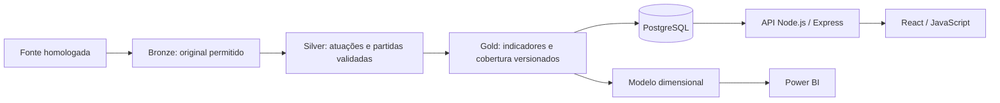

# Arquitetura inicial proposta

Data: 19/10/2026. Documento de decisão e planejamento da Fase 1, sem módulos implementados. Referências normativas: [AGENTS.md](../AGENTS.md), [contexto integral](FLAMENGO_ANALYTICS_CONTEXT.md), [recorte](ROUND_SCOPE.md) e [indicadores](METRICS.md).

## Decisões preservadas

O sistema terá pipeline Python/Pandas, dados Bronze/Silver/Gold, PostgreSQL, API Node.js/Express, React com JavaScript e Power BI. Inicialmente, processamento em lote e uma aplicação por produto são suficientes para o recorte de 19 partidas. Não há evidência de volume que justifique Spark, Hadoop, microsserviços, filas ou processamento distribuído.

Clean Architecture será aplicada desde o primeiro caso de uso. Diretórios só serão criados com responsabilidade e implementação reais. Não haverá framework de injeção de dependências, repositório genérico, interface vazia ou classe base sem necessidade.

## Fluxo dos dados e dependências do software

As setas acima representam movimentação de dados. No código, a regra é diferente: adaptadores e infraestrutura dependem das políticas internas. O domínio não conhece HTTP, React, Express, banco, arquivos ou fornecedores.

| Parte | Domínio | Aplicação | Adaptadores e infraestrutura | Composição |
| --- | --- | --- | --- | --- |
| Pipeline | Elegibilidade, presença em campo, regras de qualidade e fórmulas | Validar manifesto, ingerir, transformar, gerar Gold e carregar versão | Conector autorizado, arquivos, Pandas, PostgreSQL e entrada CLI | Ponto de entrada configura caminhos, credenciais e implementações |
| Backend | Escopo fixo, elegibilidade de consulta, políticas de ranking/comparação | Consultar atletas, perfil, resumo, comparação, metadados e cobertura | HTTP/Express/Zod, serialização e repositórios PostgreSQL | `main` conecta rotas, casos de uso e repositórios |
| Frontend | Regras de seleção/comparação que a interface realmente necessitar | Carregar visões e coordenar filtros através de gateway | Gateway HTTP; React, hooks de interface, TanStack Query e Recharts na apresentação | `app` configura navegação e injeta fluxos/gateways |
| Power BI | Definições analíticas documentadas comuns | Processo de atualização e validação | Power Query, modelo dimensional, DAX e páginas | Conexão ao conjunto Gold autorizado e identificação da versão |

Portas de saída pertencem à aplicação que as utiliza. Em JavaScript, funções ou objetos injetados com operações explícitas bastam quando não houver necessidade de classes. O domínio e os casos de uso não importam implementações concretas. Adaptadores de entrada chamam casos de uso; adaptadores de saída implementam operações de que eles precisam.

## Pipeline

Estrutura prevista, criada gradualmente: `pipeline/domain`, `pipeline/application`, `pipeline/adapters`, `pipeline/infrastructure`, `pipeline/main` e testes correspondentes. A adição do ponto de composição explicita a responsabilidade já exigida pelo contexto.

| Caso de uso proposto | Entrada e regra central | Saída | Dependência externa necessária |
| --- | --- | --- | --- |
| Validar manifesto do recorte | Partidas e evidências; identidade, rodada oficial e unicidade | Manifesto aceito ou diagnósticos de rejeição | Nenhuma para validar registros já fornecidos |
| Ingerir partidas autorizadas | Fonte homologada e manifesto; nunca aceitar um total anual como atuação | Originais, metadados e execução identificada | Leitor da fonte e armazenamento Bronze |
| Normalizar e validar atuações | Registros de origem e vínculo de IDs; clube da atuação e granularidade | Silver e rejeições rastreáveis | Leitor/escritor; adaptador Pandas para tabulação |
| Gerar indicadores do recorte | Silver validada e definições versionadas | Gold, componentes e cobertura | Leitura/escrita dos estágios |
| Publicar versão analítica no banco | Gold aprovado e permissões aplicáveis | Versão consistente de leitura | Persistência PostgreSQL transacional |

Fórmulas e invariantes serão funções internas puras, usando tipos nativos e sem importar Pandas, NumPy ou clientes de fonte. Pandas faz leitura, tabulação e adaptação nas bordas, invocando as regras do núcleo. Para esse volume, não é necessário duplicar fórmulas em um mecanismo vetorizado. Notebooks consomem os módulos e exploram resultados com as bibliotecas definidas, sem se tornarem o único lugar das regras.

Bronze preserva o conteúdo autorizado e sua origem; Silver registra dados normalizados e falhas; Gold deriva indicadores do universo elegível. Esses nomes são estágios dos dados, não substituem domínio/aplicação/adaptadores.

Idempotência: o mesmo original e a mesma versão de transformação não duplicam observações. Correção do fornecedor gera revisão rastreável; a promoção de uma nova versão não mistura snapshots antigos e novos em uma mesma leitura. Execução incompleta não substitui silenciosamente a versão aprovada.

## Persistência e granularidade

O modelo físico será definido na Fase 4, após comprovar os campos disponíveis. O núcleo mínimo proposto é:

| Entidade/conjunto | Grão e responsabilidade |
| --- | --- |
| Jogador | Identidade interna e vínculos verificáveis de IDs externos; nome não é chave |
| Clube, competição e temporada | Identidades usadas na validação e nas relações |
| Partida | Uma partida oficial, com rodada de origem, mando, realização e status |
| Vínculo de fonte | Correspondência entre ID interno e ID externo no namespace correto |
| Atuação | Jogador × partida × clube; registra presença, titularidade e estatísticas disponíveis |
| Proveniência e execução | Fonte, recurso, instante de coleta, hash, revisão e execução |
| Cobertura e rejeições | Métrica, partida/atuação, estado, motivo e evidência |
| Gold do recorte | Jogador × competição × temporada × clube × recorte × versão analítica |

No armazenamento de origem, preservar fonte e revisão permite múltiplas observações. Na Silver canônica, selecionar explicitamente a versão/fonte aceita para cada observação, sem somar duas fontes para o mesmo evento. Não é necessário implementar um catálogo genérico de entidades antes de haver uma segunda fonte.

Uma tabela denominada apenas `player_season_stats` não identifica adequadamente o primeiro turno. Agregados persistidos precisam carregar o recorte e a versão, ou ser views sobre fatos elegíveis. Chaves estrangeiras, unicidade, limites de rodada, valores válidos e consultas parametrizadas serão definidos nas migrações. A validade do recorte permanece também no domínio; uma restrição SQL isolada não substitui essa política.

Permissões de banco devem separar gravação pelo pipeline e leitura analítica. Segredos ficam na configuração de infraestrutura. Payloads, SQL, stack traces e tokens não serão expostos em erros públicos ou logs.

## API e apresentação

Os endpoints do contexto são propostas, não serviços existentes. A primeira entrega deve começar por metadados/cobertura e consulta de jogadores, ampliando depois para rankings, perfis, comparação e exportações.

Controllers validam formato com Zod e delegam. O caso de uso mantém o universo Série A/2026/Flamengo/rodadas 1–19 mesmo sem filtros enviados pelo cliente. Parâmetros que tentem ampliar esse universo serão rejeitados; filtros permitidos só reduzem o conjunto. SQL ficará nos repositórios concretos, com parâmetros e ordenação por lista permitida.

Respostas deverão transportar números sem formatação, disponibilidade, unidade, cobertura, definição da métrica, fonte e versão analítica. Caches precisam incluir recorte, versão e filtros. Valores indisponíveis usam representação explícita, nunca zero substituto.

React formata em português brasileiro e apresenta carregamento, erro, vazio e cobertura parcial. Componentes não acessam PostgreSQL nem recalculam os totais recebidos a partir de uma página incompleta da tabela. Gateways escondem transporte e formato externo; o domínio frontend não importa React, TanStack Query ou Fetch. Regras analíticas principais permanecem nos dados aprovados; não duplicar cálculos sem necessidade de interação local.

## Power BI e consistência

Propor fato de atuação por partida e dimensões Jogador, Posição quando suportada, Partida, Clube, Competição, Temporada e Data quando útil. Rodada pertence à partida; a dimensão Data não decide elegibilidade. A posição atual do jogador não deve reclassificar silenciosamente suas atuações históricas.

Power BI usará a mesma versão Gold da API, por exportação autorizada ou views analíticas controladas. Evitar relacionar fato agregado e fato detalhado de maneira que duplique valores. DAX soma componentes e usa divisão segura, respeitando ausências; a tela mostra o rótulo fixo do primeiro turno. Arquivo PBIX/PBIP com dados embutidos só será compartilhado quando permitido.

Uma definição de indicadores em Markdown, componentes persistidos, versão de transformação e verificações de paridade entre Python, SQL, API, React e DAX manterão a semântica. Não haverá tentativa de importar código Python no JavaScript; a equivalência entre linguagens será verificada por resultados sobre o mesmo universo.

## Primeira fatia e critérios arquiteturais

A futura Fase 2 deve implementar somente a elegibilidade e a validação do manifesto com entrada local de teste, sem conector de produção. Casos de teste técnicos ficarão separados dos dados esportivos reais. A fatia seguinte será a ingestão de uma fonte homologada.

Critérios de aceite: imports apontam para o núcleo; domínio/casos de uso funcionam sem rede/banco; composição ocorre na borda; não há regra analítica em controller/componente; não há comentários novos em código; nenhum diretório ou contrato vazio é criado. Testes de dependência devem acompanhar os módulos reais, sem exigir camadas artificiais.

Decisões que dependem de amostra: fornecedor, esquema físico, convenção de minutos, taxonomia de posição, granularidade de passes e desarmes, armazenamento de correções e formato final dos DTOs. Não antecipar essas decisões com dados inventados.
