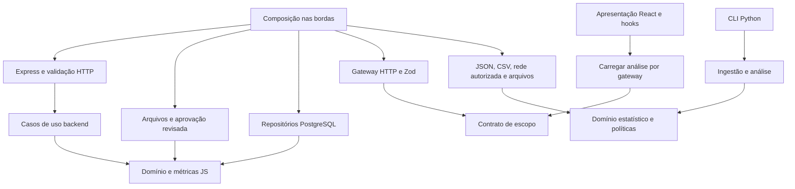

# Arquitetura implementada

Escopo vigente: Flamengo, Série A masculina de 2025, rodadas oficiais 1–38. O planejamento integral está no contexto; este documento descreve o código atual, inclusive componentes preparados que ainda não recebem dados individuais.

## Dependências e composição

Domínio/aplicação não importam Express, React, Zod, drivers SQL, Pandas, filesystem ou serviços externos. Portas são funções/objetos concretamente usados, sem hierarquias decorativas. Bronze/Silver/Gold organizam dados; as camadas de software permanecem separadas.

| Camada                                         | Responsabilidades                                                                      |
| ---------------------------------------------- | -------------------------------------------------------------------------------------- |
| packages/domain/src                            | Escopo fixo, somas completas, razões ponderadas, agregação, quartis e outliers         |
| backend/src/domain                             | Elegibilidade, população/filtros, ordenação, envelope e aprovação de dataset           |
| backend/src/application                        | Consultas analíticas por porta read(), comparação e importação por porta store()       |
| backend/src/interfaces/http                    | Schemas Zod de query/UUID, CSV, rate limit, controllers e erros                        |
| backend/src/infrastructure                     | Configuração, schemas de arquivo, hashing, mapeamento OpenFootball e repositórios SQL  |
| backend/src/main                               | Pool opcional, injeção, servidor, migrações e comandos explícitos de importação        |
| frontend/src/features/analytics/domain         | Rejeição de escopo incompatível e vocabulário dos indicadores                          |
| frontend/src/features/analytics/application    | Fluxo loadAnalytics com gateway injetado                                               |
| frontend/src/features/analytics/infrastructure | Fetch, cancelamento e validação do envelope                                            |
| frontend/src/features/analytics/presentation   | Estados, hooks TanStack, tabelas, páginas, filtros e gráficos                          |
| frontend/src/app                               | Providers, roteamento, layout e estilo global                                          |
| pipeline/domain                                | Modelos, manifesto, elegibilidade, auditoria, permissões e matemática pura             |
| pipeline/application                           | Coordenação da auditoria/ingestão, análise por atleta e exportação BI                  |
| pipeline/infrastructure                        | Parsing/JSON Schema, adaptadores de fonte, Pandas, hashes, downloads e escrita atômica |
| pipeline/adapters e main                       | Serialização CLI e composição; execução dos kernels Jupyter nas bordas                 |

A feature analytics concentra o fluxo compartilhado de leitura: as páginas usam os mesmos filtros, envelope, tabela e estados. Não foram criadas quatro camadas vazias para cada rota. A feature project-status anterior foi preservada com testes; o ponto de entrada atual monta Dashboard. Os cálculos canônicos não ficam em JSX. React apenas apresenta valores e formata pt-BR.

## Fluxos de dados

OpenFootball: revisão fixa autorizada → download opcional com hash → domínio valida 38 referências → Bronze fiel → Silver normalizada → Gold auxiliar. Reexecução do mesmo artefato mantém recibo e bytes. O leitor da API confere a revisão/raw e reconstrói os campos de partida desse conteúdo, preservando os localizadores originais. Não inventa UUID, ID CBF ou fuso.

Individual: arquivo conforme JSON Schema → aprovação exata de conteúdo/finalidade/permissões → invariantes de identidade/partida → Gold canônica. Não há fonte aprovada atualmente. Cobertura completa requer revisão documental de participações e mapeamento oficial, além das 38 rodadas. Um cliente HTTP ou parâmetro CLI não pode aprovar esses requisitos.

Sem DATABASE_URL, a porta de leitura usa Gold local homologada. Com DATABASE_URL, a porta PostgreSQL exige que a mesma versão/hashing aprovado esteja carregada; versão ausente mantém indisponibilidade. A importação SQL é explícita, transacional, parametrizada, protegida por advisory lock e idempotente pelo hash. IDs externos são namespaceados por fonte e conflitos de identidade não reclassificam partidas ou jogadores.

A migração 003 acrescenta imports/fatos, índices, FKs/checks e vínculo de escopo com partida concluída. 001/002 permanecem históricas; a 002 recusa banco com partidas antigas. A aplicação não aplica migrações ao iniciar. Não há sementes.

Power BI recebe somente exportação própria autorizada para esse canal. Os notebooks leem a auditoria e só analisam o artefato individual quando passa pelo mesmo portão. O kernel usa a .venv, não altera configuração global do Jupyter.

## Semântica e segurança

Nulls não viram zero. Somas exigem componentes conhecidos em todas as observações selecionadas. Taxas usam somas de numeradores/denominadores; divisão inválida retorna null. Quartis usam interpolação linear (n−1)p. Agregações parciais são rotuladas; resumo anual é bloqueado.

Schemas de transporte estão nas bordas; regras de aprovação/cobertura ficam no domínio. A duplicação matemática JS/Python é limitada e protegida por fixture neutra com resultados esperados. PostgreSQL conserva componentes; API calcula no núcleo; React formata; DAX está preparado, ainda sem validação no motor Desktop.

ESLint e testes AST verificam imports, inclusive imports dinâmicos, e ciclos JS. Python usa AST/tokenização. Comentários/docstrings novos são recusados, inclusive código dos notebooks. HTTP tem CORS explícito, Helmet, limites, ordenação permitida e erros sem detalhes internos. SQL só interpola listas internas de colunas; valores externos são parâmetros.

Os processos executam nativamente no Windows. Sem infraestrutura distribuída ou containers. Testes SQL usam cluster isolado; nenhum banco pessoal foi migrado. CI remoto, Power BI Desktop e revisão visual completa permanecem pendentes.
